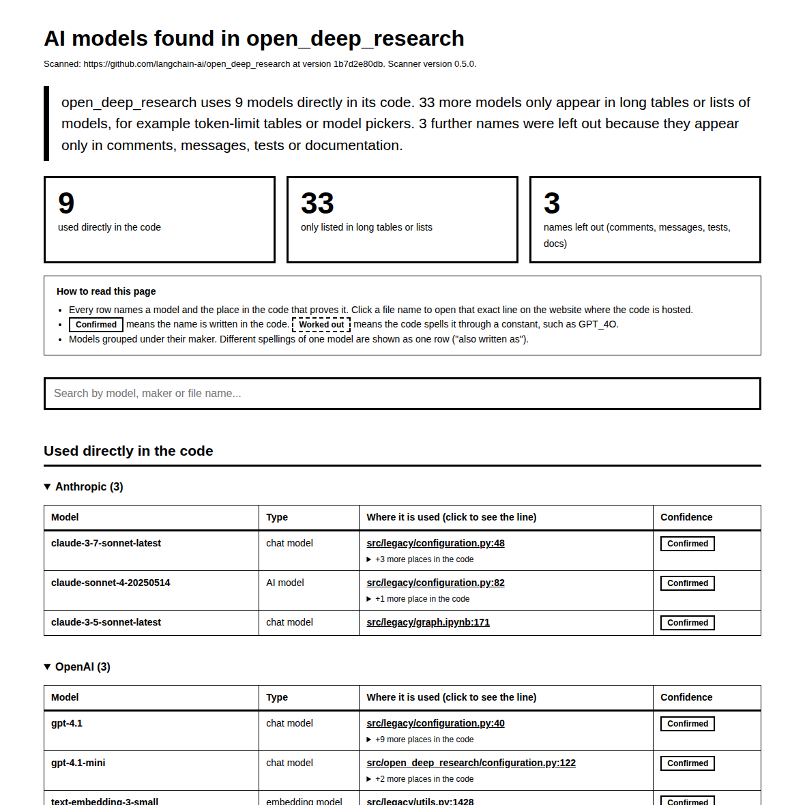
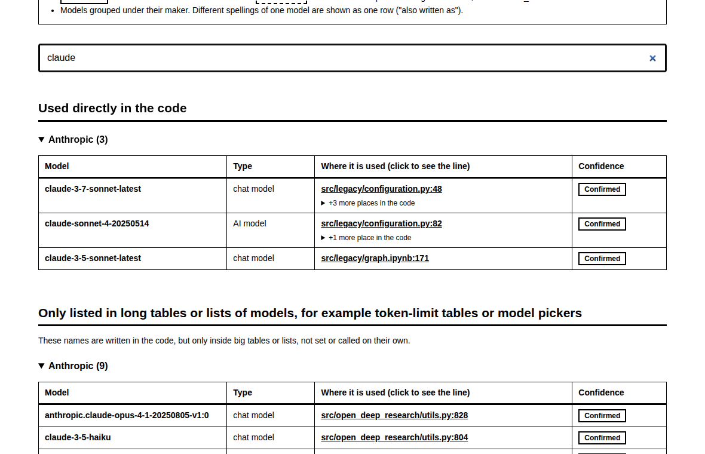
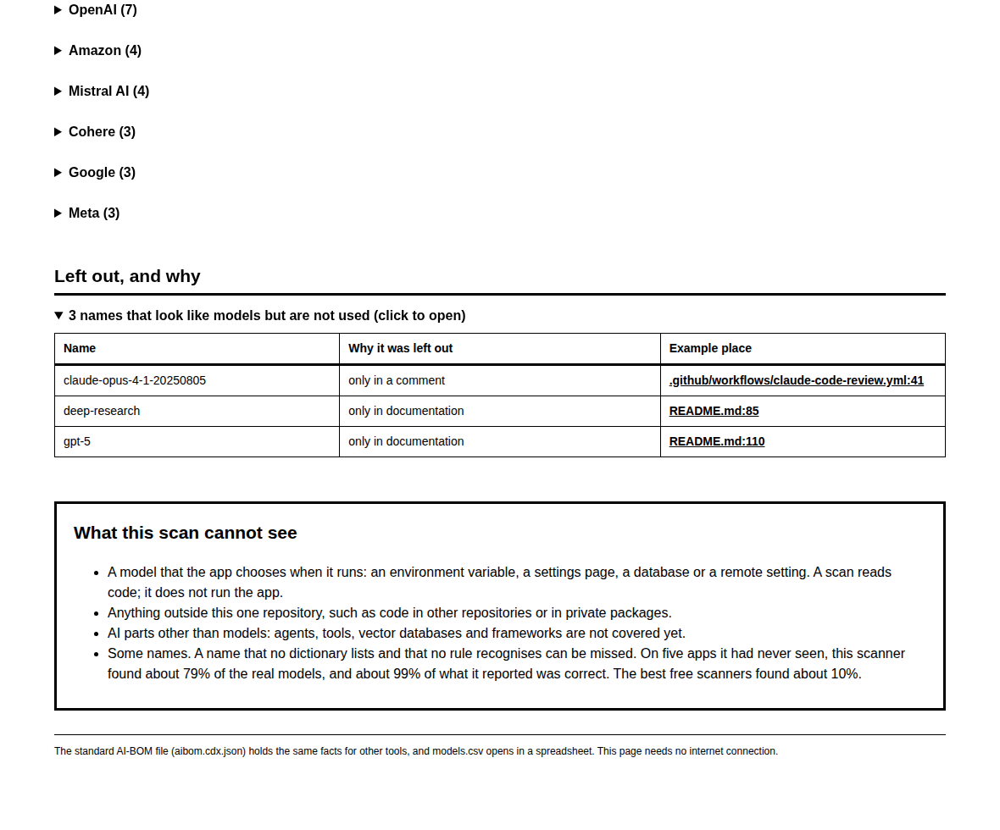

# Tutorial: showing the AI models scanner (version 0.5.0)

This is a complete, step-by-step guide. If you follow it from top to bottom you can set the tool up, run every demo command, read the browser report, handle any repository someone names in a meeting, and explain what was built and what was polished.

## What you are showing, in one minute

The scanner reads the code of an AI app and answers one question: which AI models does this app use, and where is the proof? It writes the answer in three forms:

- a web page anyone can read (report.html),
- a spreadsheet (models.csv),
- the standard AI-BOM file (aibom.cdx.json, CycloneDX 1.6) that other security tools can read.

Every model comes with the file and line of code that proves it, and, when you scan from a GitHub link, a clickable link to that exact line. Names that appear only in comments, printed messages, tests or documentation are left out, and the page says why.

The honest numbers (apps the scanner had never seen, answer keys written first): it found about 79% of the real models, about 99% of what it reported was correct, and the best free scanners found about 10%. It finds AI models only so far.

## Part 1. Set it up once (about 10 minutes)

1. Install Python 3.9 or newer and git.
   - Windows: python.org (tick "Add Python to PATH" in the installer) and git-scm.com.
   - Mac: `brew install python git`, or the installers from the same two websites.
   - Linux: `sudo apt install python3 python3-pip python3-venv git`.
2. Unzip `aibom-engine.zip`. Open a terminal inside the `aibom-engine` folder.
   - Windows: open the folder in File Explorer, click the address bar, type `cmd` and press Enter.
   - Mac: right-click the folder and choose "New Terminal at Folder".
3. Install the two packages it needs:

       python -m pip install -r requirements.txt

   If `python` is not found, try `py` (Windows) or `python3` and `pip3` (Mac and Linux). Use the same word in every command below.
4. Check everything, including the internet:

       python scripts/preflight.py

   You should see lines starting with `[ok]` and the sentence "Ready for the meeting." A line starting with `[FIX]` tells you what to do.

Ten minutes before a meeting, run step 4 again. It also tells you whether scanning from a link will work on that network.

## Part 2. The demo commands, one by one

All commands are run from the `aibom-engine` folder. The easiest way is the guided script, which pauses before each step so you can talk first and press Enter to run it:

    Windows PowerShell:  powershell -ExecutionPolicy Bypass -File demo\run_demo.ps1
    Mac or Linux:        bash demo/run_demo.sh

To type the commands yourself, first download the demo app at the exact version used in the tests:

    python scripts/fetch_repos.py --dir demo/apps open_deep_research

### Step 1. Scan the app

    python -m aibom_engine scan demo/apps/open_deep_research --out runs/open_deep_research

What you see:

```

Scan finished in 1.12s: open_deep_research
Source: https://github.com/langchain-ai/open_deep_research (version 1b7d2e80db)

  9    models used directly in the code
  33   more only listed in long tables or lists
  3    names left out (only in comments, messages, tests or docs)

The main ones:
  MODEL                        MADE BY    TYPE        WHERE (file:line)
  gpt-4.1                      OpenAI     chat model  src/legacy/configuration.py:40  (+9 more)
  claude-3-7-sonnet-latest     Anthropic  chat model  src/legacy/configuration.py:48  (+3 more)
  gpt-4.1-mini                 OpenAI     chat model  ...eep_research/configuration.py:122  (+2 more)
  claude-sonnet-4-20250514     Anthropic  model       src/legacy/configuration.py:82  (+1 more)
  claude-3-5-sonnet-latest     Anthropic  chat model  src/legacy/graph.ipynb:171
  DeepSeek-R1-Distill-Llama-7~ DeepSeek   chat model  src/legacy/graph.ipynb:181
  llama-3.3-70b-versatile      Meta       chat model  src/legacy/graph.ipynb:183
  sonar-pro                    Perplexity chat model  src/legacy/utils.py:315
  ... and 1 more (use --all, or open the report)

Files in runs/open_deep_research:
  report.html     the readable report: open it in a browser (python -m aibom_engine report runs/open_deep_research)
  models.csv      the same list for a spreadsheet
  aibom.cdx.json  the standard AI-BOM file (valid CycloneDX 1.6)

Next:  python -m aibom_engine show runs/open_deep_research --all      list every model
       python -m aibom_engine explain runs/open_deep_research MODEL   why is this model here?
Limits: finds AI models only. It cannot see a model chosen when the app runs.
```

What to say: "It sorted the files, looked for model names, and checked each one. Nine models are used directly in the code. Thirty-three more only appear in long tables, like a table of token limits. Three names were left out because they only appear in comments or documentation." Because this folder is a git clone, every line has a link to the website.

### Step 2. The list, most important first

    python -m aibom_engine show runs/open_deep_research

```
open_deep_research: 9 models used directly in the code, 33 only listed in long tables or lists, 3 names left out

  MODEL                        MADE BY    TYPE        WHERE (file:line)
  gpt-4.1                      OpenAI     chat        src/legacy/configuration.py:40  (+9 more)
  claude-3-7-sonnet-latest     Anthropic  chat        src/legacy/configuration.py:48  (+3 more)
  gpt-4.1-mini                 OpenAI     chat        ...eep_research/configuration.py:122  (+2 more)
  claude-sonnet-4-20250514     Anthropic  model       src/legacy/configuration.py:82  (+1 more)
  claude-3-5-sonnet-latest     Anthropic  chat        src/legacy/graph.ipynb:171
  DeepSeek-R1-Distill-Llama-7~ DeepSeek   chat        src/legacy/graph.ipynb:181
  llama-3.3-70b-versatile      Meta       chat        src/legacy/graph.ipynb:183
  sonar-pro                    Perplexity chat        src/legacy/utils.py:315
  text-embedding-3-small       OpenAI     embedding   src/legacy/utils.py:1428

  Also 33 models only listed in long tables. See them with: python -m aibom_engine show runs/open_deep_research --all
```

What to say: "The first column is the model, then who makes it, then the type, then the file and line that proves it. The number in brackets is how many other places use it."

### Step 3. Why is this model here, and how sure are we?

    python -m aibom_engine explain runs/open_deep_research gpt-4.1-mini

```
gpt-4.1-mini  (OpenAI, chat model)
  How it is used:  set or used directly in the code
  How sure:        Confirmed: the name is written in the code
  Written in 3 places in code and settings:
    src/open_deep_research/configuration.py:122
        default="openai:gpt-4.1-mini",
        https://github.com/langchain-ai/open_deep_research/blob/1b7d2e80db9faa586165c60e09096dbbfd483a64/src/open_deep_research/configuration.py#L122
    src/open_deep_research/configuration.py:126
        "default": "openai:gpt-4.1-mini",
        https://github.com/langchain-ai/open_deep_research/blob/1b7d2e80db9faa586165c60e09096dbbfd483a64/src/open_deep_research/configuration.py#L126
    src/open_deep_research/utils.py:789
        "openai:gpt-4.1-mini": 1047576,
        https://github.com/langchain-ai/open_deep_research/blob/1b7d2e80db9faa586165c60e09096dbbfd483a64/src/open_deep_research/utils.py#L789
  Also seen in 6 other places that do not count (comments, tests, documentation).
```

What to say: "This is the question I expect in a meeting: why is it in the list? The answer is three real places in the code, each with a link to the exact line on GitHub. The last line says it was also seen in six places that do not count, such as documentation and tests." You can ask about any model, and also about a left-out name; it will tell you why it was not counted.

### Step 4. The names that were left out

    python -m aibom_engine show runs/open_deep_research --left-out

```
open_deep_research: 3 names were left out because they are not really used

  NAME                           WHY                                          EXAMPLE PLACE
  claude-opus-4-1-20250805       only in a comment                            ...lows/claude-code-review.yml:41
  deep-research                  only in documentation                        README.md:85
  gpt-5                          only in documentation                        README.md:110
```

What to say: "These look like models but are not used. One is in a comment, two are in the README. This is how it avoids padding the list with names that are only mentioned."

### Step 5. Every model, including the ones only listed in tables

    python -m aibom_engine show runs/open_deep_research --all

```
open_deep_research: 9 models used directly in the code, 33 only listed in long tables or lists, 3 names left out

  MODEL                        MADE BY    TYPE        ROLE    WHERE (file:line)
  gpt-4.1                      OpenAI     chat        used    ...gacy/configuration.py:40  (+9 more)
  claude-3-7-sonnet-latest     Anthropic  chat        used    ...gacy/configuration.py:48  (+3 more)
  gpt-4.1-mini                 OpenAI     chat        used    ...arch/configuration.py:122  (+2 more)
  claude-sonnet-4-20250514     Anthropic  model       used    ...gacy/configuration.py:82  (+1 more)
  claude-3-5-sonnet-latest     Anthropic  chat        used    src/legacy/graph.ipynb:171
  DeepSeek-R1-Distill-Llama-7~ DeepSeek   chat        used    src/legacy/graph.ipynb:181
  llama-3.3-70b-versatile      Meta       chat        used    src/legacy/graph.ipynb:183
  sonar-pro                    Perplexity chat        used    src/legacy/utils.py:315
  text-embedding-3-small       OpenAI     embedding   used    src/legacy/utils.py:1428
  llama2                       Meta       chat        listed  ...eep_research/utils.py:817  (+2 more)
  anthropic.claude-opus-4-1-2~ Anthropic  chat        listed  ...eep_research/utils.py:828
  claude-3-5-haiku             Anthropic  chat        listed  ...eep_research/utils.py:804
  claude-3-5-sonnet            Anthropic  chat        listed  ...eep_research/utils.py:803
```

### Step 6. The readable report in the browser

    python -m aibom_engine report runs/open_deep_research

This opens `report.html`. Part 3 explains what is on the page and what to click.

### Step 7. The same model in the standard AI-BOM file

    python -m aibom_engine show runs/open_deep_research --item gpt-4.1-mini

```
{
 "bom-ref": "model:gpt-4.1-mini",
 "evidence": {
  "occurrences": [
   {
    "additionalContext": "live: default=\"openai:gpt-4.1-mini\",",
    "line": 122,
    "location": "src/open_deep_research/configuration.py"
   },
   {
    "additionalContext": "live: \"default\": \"openai:gpt-4.1-mini\",",
    "line": 126,
    "location": "src/open_deep_research/configuration.py"
   },
   {
    "additionalContext": "live: \"openai:gpt-4.1-mini\": 1047576,",
    "line": 789,
    "location": "src/open_deep_research/utils.py"
   }
  ]
 },
 "name": "gpt-4.1-mini",
```

What to say: "This is the format other security tools understand. It follows CycloneDX 1.6 and is checked against the official schema every time. The proof lines are stored inside it."

### Step 8. Compared with the four free scanners

    python benchmark/score.py open_deep_research runs/open_deep_research --compact

```
open_deep_research: 4 real models in the answer key

tool                     found  reported  correct  precision
cisco                    0/4           0        0          -
cdxgen                   1/4           7        1        14%
trusera                  0/4           1        0         0%
aibom-scanner            0/4           0        0          -
engine (verified)        4/4          42       42       100%
```

What to say: "I wrote the correct list of models by hand before running anything: four models. Our scanner found all four. The best free scanner found one, and reported seven names to do it, six of them wrong."

### Step 9. Results on apps it had never seen

    python benchmark/summary_all.py

The first block is the honest one. It shows five apps that the scanner had never seen when it was frozen: it finds between 66% and 96% of the real models, about 99% of its reports are correct, and the best free scanner per app finds between 2% and 23%. The later blocks are apps the fixes were built on, so their higher numbers prove less. Say so before anyone asks.

### Step 10. Live on any repository

    python -m aibom_engine scan https://github.com/OWNER/REPO --open

Also accepted: `owner/repo`, a link to one folder (`.../tree/main/some/folder`), or a folder on your computer. The scanner downloads a copy, scans it, deletes the copy, and opens the report. If the link is wrong, private, or there is no internet, it says so in one plain sentence:

```

Problem: I could not find a folder or a git link called 'not-a-real-thing-xyz'. Give me a folder on this computer, or a link like https://github.com/owner/repo
exit code 2
```

For a repository that names no models you get an honest "none found" and the reason (the app may choose its model when it runs):

```

Scan finished in 0.07s: no AI model names found in Hello-World.
  The app may choose its model when it runs (an environment variable, a settings page, a database), or use none.

Files in runs/Hello-World:
  report.html     the readable report: open it in a browser (python -m aibom_engine report runs/Hello-World)
  models.csv      the same list for a spreadsheet
  aibom.cdx.json  the standard AI-BOM file (valid CycloneDX 1.6)

Next:  python -m aibom_engine show runs/Hello-World --all      list every model
       python -m aibom_engine explain runs/Hello-World MODEL   why is this model here?
Limits: finds AI models only. It cannot see a model chosen when the app runs.
```

### Extra commands

- `python -m aibom_engine rebuild runs/open_deep_research` rebuilds the report and spreadsheet from saved data, without scanning again. `rebuild runs --all` does it for every saved scan.
- `models.csv` opens in Excel or Google Sheets. It has one row per model with the maker, type, confidence, first place and the link.
- `python -m aibom_engine scan REPO --max-seconds 300` raises the time limit (the default is 120 seconds, and the scan says so if it is hit).
- `python -m aibom_engine scan REPO --keep` keeps the downloaded copy so you can look at the code.

## Part 3. Reading the browser report

The report is black and white, prints cleanly, works with no internet, and fits a phone screen.



1. The headline sentence says in plain words how many models the app uses directly, how many only appear in tables, and how many names were left out.
2. The three big numbers repeat that. Point at the first one: "used directly in the code".
3. "How to read this page" explains the two badges: Confirmed (the name is written in the code) and Worked out (the code spells it through a constant such as GPT_4O).
4. Models are grouped under their maker (OpenAI, Anthropic, and so on). Different spellings of one model are shown as one row, with "also written as" underneath.
5. "Where it is used": click the file and line to open that exact line on GitHub. "+3 more places in the code" opens the other places.



6. The search box filters by model, maker or file name as you type. Try "claude" in the demo.



7. "Left out, and why" lists names that look like models but are not used, each with its reason and a link.
8. "What this scan cannot see" is the honest box at the bottom. It says what a code scan cannot know and repeats the tested accuracy. Point at it yourself before anyone asks.

## Part 4. Live on any repo: what to expect and what to say

Ask the person for a repo, paste the link, and talk through the progress lines. Most repositories finish in 5 to 40 seconds; the very largest take one to two minutes. If the time limit stops a scan, the page shows a warning banner.

Checked from links on an idle machine (`benchmark/stress_test.md`; this measures stability and speed, not accuracy):

| Link | Total seconds | Scan seconds | Used directly | Only listed | Left out | Result | Note |
|---|---|---|---|---|---|---|---|
| openai/openai-cookbook | 83 | 19.5 | 80 | 1 | 73 | ok |  |
| huggingface/transformers | 106 | 95.46 | 373 | 31 | 464 | ok |  |
| langchain-ai/langchain | 21 | 15.94 | 88 | 216 | 53 | ok |  |
| ollama/ollama | 14 | 10.04 | 76 | 45 | 40 | ok |  |
| microsoft/semantic-kernel | 37 | 31.23 | 113 | 26 | 32 | ok |  |
| BerriAI/litellm | 146 | 125.63 | 284 | 239 | 856 | ok |  |
| pallets/flask | 3 | 0.61 | 0 | 0 | 0 | ok |  |
| octocat/Hello-World | 2 | 0.06 | 0 | 0 | 0 | ok |  |
| langchain-ai/open_deep_research/tree/main/src/legacy | 3 | 0.49 | 8 | 0 | 2 | ok |  |
| octocat/this-repo-does-not-exist-12345 | 2 | - | 0 | 0 | 0 | polite error | Problem: I could not open https://github.com/octocat/this-repo-does-not-exi |
| not a link | 2 | - | 0 | 0 | 0 | polite error | Problem: I could not find a folder or a git link called 'not a link'. Give  |

Three kinds of result you may see:

- A normal app (a few models in settings or code). The report shows them with proof. Open one link on GitHub to show the line.
- A library or a catalog repo (huge lists of models). The page separates the models it actually uses from the long tables, and the numbers look big. Say: "This is a library about models, so the list is long. The 'used directly' group is the one that matters."
- No models at all, or an app that picks its model at run time. Say: "It found none, and here is why. A scan reads code; it cannot see a model chosen from an environment variable or a database."

If it misses a model you know is there, say so plainly: it can miss names that no dictionary lists and no rule recognises. The known pattern: unknown ids sitting inside long lists or JSON catalogs (for example, many `"id": "..."` entries). Say it is on the list of fixes, and show that every result it does give has a checkable line.

## Part 5. A 6-minute running order

| Time | Do | Say |
|---|---|---|
| 0:00 | Slide or voice only | "Before you can secure an AI app, you need to know which models it uses. The free tools miss most of them. This finds them and shows the line of code as proof." |
| 0:30 | Step 1 and 2 | "One command. Nine models used directly, thirty-three only listed, three left out." |
| 1:15 | Step 3 | "Ask it why a model is here. It answers with the exact lines, and links." |
| 2:00 | Step 6 (browser) | Walk the page: headline, numbers, badges, search, click a line, left-out, limits box. |
| 3:30 | Step 7 | "And the standard file for other security tools." |
| 4:00 | Step 8 and 9 | "Same app against four free scanners, then the apps it had never seen: about 79% found, 99% correct, free tools about 10%." |
| 5:00 | Step 10 | "Give me any repo." Paste, scan, open one link. |
| 6:00 | Close | "It finds AI models only. It cannot see a model chosen when the app runs. Next: fix the known gaps and test on new apps." |

## Part 6. What we did to polish it

Detection (what it finds) and presentation (what people read) were handled separately, so improving one could not quietly change the other.

| Version | What changed | How it was checked |
|---|---|---|
| 0.3.0, ready for any repo | Scan straight from a GitHub link. Progress lines. A time limit. Plain error messages (wrong link, private repo, no internet, no git). A clear answer when no models are found. Models marked used directly or only listed in long tables (open_deep_research went from "42 models used" to 9 used and 33 listed). A pre-meeting check (`scripts/preflight.py`). | 52 tests. Stress test on 11 links from huge repos to broken links. Six edge cases (empty folder, odd characters, binary files, and more). A spot check of random rows found langchain's data files counted as used; a rule for files naming 20 or more models fixed it (303 used became 87 used and 216 listed). |
| 0.4.0, finds more | A new finder that spots names by shape: constants whose name spells the string, keys learned from the file, bare family names under a model key, version-shaped strings and Bedrock ids, Bicep allowed lists. Example payloads in API specs are ignored. | Built using only the old apps, then frozen, then run once on five new apps whose answer keys were written first: 79% found, 99% correct. The first version of the Bicep rule produced false alarms (a region name, an index name); they were found by reading every new name and fixed, with tests. |
| 0.5.0, readable and useful | The report rebuilt (headline, three numbers, grouped by maker, search, confidence badges, clickable lines, left-out reasons, limits box). A clearer terminal summary with a table. `explain`, `show --all`, `show --left-out`, `rebuild`. A spreadsheet export. Different spellings of one model shown as one row. Links also for any local git clone. | The page was opened in a real browser: search tested, phone width tested. 92 automated tests, also run on a real Python 3.9. All 17 test repos re-scanned: names and verdicts identical to before the polish, and the detection code has the identical fingerprint. So the polish changed what people see, not what the scanner finds. |

Things that went wrong along the way, and how they were caught (worth knowing in case you are asked):

- The first report said "42 models are used" when the app really sets about 4. Fixed by separating used from listed.
- My own answer keys missed real models (17 in the Swift repo, `claude-opus-5`, `morph-v3-large`). A second, different search found them. Keys are still written by me and not reviewed by a person.
- One wrong commit hash was written into a key; it was replaced with the real one before any result was produced.
- The stress test script recorded zeros after the wording of the summary changed. It was noticed, fixed and rerun.
- A background scanner made the first timings look 3 to 4 times too slow. Timings were remeasured on an idle machine. The new finder makes very large and notebook-heavy repos two to three times slower (transformers: 32 seconds without it, between 66 and 95 with it). A catalog library like litellm takes a little over two minutes in total; reading its files stayed inside the 120-second limit, and the checks that follow added the rest. If the limit ever does stop a scan, the page shows a warning banner saying it may be incomplete.

## Part 7. Honest numbers, limits, and answers to hard questions

| Question | Answer |
|---|---|
| How accurate is it? | On five apps it had never seen, it found 66% to 96% of the real models (79% on average), and about 99% of its reports were correct. Free scanners found about 10%. The answer keys were written by me, not an independent person. |
| Why not 100%? | Mostly names no dictionary lists, sitting inside long lists or JSON catalogs. It also cannot see a model that an app picks when it runs. |
| Is it better than Cisco, cdxgen and the others? | On these apps, yes by a wide margin. Cisco's first-pass mode was used; its stronger mode needs a paid AI key I could not test. |
| Does it solve a real problem? | It is the first step of an AI-BOM: knowing exactly which models an app uses, with proof. No customer has told us they would use it yet, so the next proof is a real company app. |
| What does it not do? | AI models only. No agents, tools, vector databases or frameworks. It reads code and does not run it. |
| Can I trust the proof lines? | Click one. That is the point: every row can be checked in seconds. |

## Part 8. Troubleshooting

| What you see | What to do |
|---|---|
| `python` is not recognized | Use `py` (Windows) or `python3` (Mac and Linux), everywhere. |
| "Two Python packages are missing" | `python -m pip install -r requirements.txt` |
| "git is not installed" | Install git from git-scm.com, then reopen the terminal. |
| "I could not reach the internet" | Use saved results: `python -m aibom_engine show runs/open_deep_research` and `python -m aibom_engine report runs/open_deep_research`. |
| "The link may be wrong, or the repository is private" | Check the spelling. For a private repo, download the code and scan the folder. |
| The scan seems slow | Large repos can take a minute or two. It stops at 120 seconds and says so. Add `--max-seconds 300`. |
| Zero models found | Normal for some apps. The report explains why. |
| The report shows no links | A local folder that is not a clean git clone has no web address. Scan the GitHub link instead. |
| PowerShell blocks the script | Use `powershell -ExecutionPolicy Bypass -File demo\run_demo.ps1`. |

## Part 9. What is in the folder

- `aibom_engine/` the scanner. `finders/` has the three finders; `verify.py` decides what is really used; `display.py` and `report.py` build what people read; `source.py` downloads repos and builds links; `cli.py` is the commands.
- `demo/` this tutorial, the meeting guide, the guided demo scripts, the voice-over script.
- `benchmark/` the test apps, hand-written answer keys, the free scanners' raw output, scoring scripts, `RESULTS.md` (all results and caveats), `stress_test.md`.
- `scripts/` `preflight.py`, `setup_check.py`, `fetch_repos.py`, `run_all.py`, `compare_runs.py`, `stress_test.py`.
- `runs/` saved results for the 17 test apps (plan B with no internet).
- `tests/` 92 automated tests: `python -m unittest discover -s tests`.
